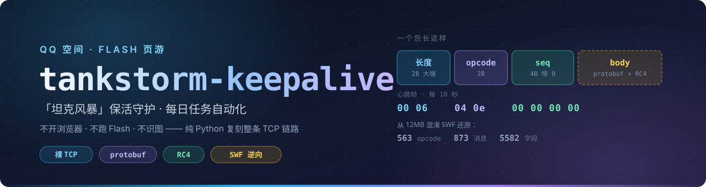

<p align="center">
  
</p>

<p align="center">
  
  
  
  
  
  
  
</p>

<p align="center">
  <b>QQ 空间 Flash 页游「坦克风暴」的保活守护与每日任务工具</b><br>
  纯 Python 复刻整条 TCP 链路，浏览器、Flash 和截图识图都用不上
</p>

<p align="center">
  <a href="#安装">安装</a> ·
  <a href="#第一次运行">第一次运行</a> ·
  <a href="#保活">保活</a> ·
  <a href="#每日任务">每日任务</a> ·
  <a href="#部署到服务器">部署</a> ·
  <a href="https://github.com/Dimlitter/tankstorm-keepalive/wiki">原理 Wiki</a>
</p>

> 本项目免费开源，仅供学习研究，不提供任何形式的付费服务。
> 下载或使用即视为同意[免责声明](#免责声明)。

---

```bash
python main.py --login           # 第一次：扫码登录
python main.py --daily           # 每日任务：跑一轮，退出
python main.py --keepalive       # 保活：常驻，防掉线
python main.py --country-war 10  # 国战：打魔多军团 10 次，退出
```

---

## 目录

- [这是什么](#这是什么)
  - [超级强攻的自动拒绝](#超级强攻的自动拒绝)
- [开始之前](#开始之前)
- [三个独立的入口](#三个独立的入口)
- [安装](#安装)
- [第一次运行](#第一次运行)
- [登录](#登录)
- [保活](#保活)
- [每日任务](#每日任务)
- [国战](#国战)
- [部署到服务器](#部署到服务器)
- [配置](#配置)
- [安全机制](#安全机制)
- [命令一览](#命令一览)
- [排错](#排错)
- [开发](#开发)
- [授权](#授权)
- [免责声明](#免责声明)

---

## 这是什么

| 能力 | 说明 |
|---|---|
| 保活 | 连游戏 socket 定时发心跳，防止长时间无操作被踢下线导致基地被打 |
| 每日任务 | 自动做签到、英雄开采、将领冶炼、技能书、特工派遣、配件探索、军备制造、战略训练、军事演习、矿区争夺、国家宝箱、公会捐献等 |
| 国战 / 争霸战 | 自动打世界地图上的魔多军团，自动挑战争霸战擂台（优先挑 NPC）|
| 事件告警 | 被超级强攻时 PushPlus 推到微信，带进攻方名字 |
| 自动拒绝超级强攻 | 收到强攻通知后自动发出拒绝包，无需人工守在电脑前 |

不做的事：**不参与游戏内人机验证（超级强攻验证码）的识别、填写或自动应答。**
脚本只负责观察、解码，并及时通知用户本人。

### 超级强攻的自动拒绝

被超级强攻时，防守方只有约 5 分钟窗口做出反应，错过基地就会被打。
保活进程收到强攻通知 `RseSuperStormOpt(027c)` 后会：

1. 从通知里取出进攻方的 `atkUid` / `atkName`
2. 构造 `RceSuperStormOpt(04ab) type=2` 拒绝包并发回服务端
3. 通过 PushPlus 把结果推到微信，带上进攻方名字

配置项是 `录制.自动拒绝超级强攻`，默认开启。依赖实时解密，
密钥自检没通过时拒绝包发不出去，日志会明确说明原因。

若服务端要求先通过验证码才接受拒绝，此包可能被忽略，所以告警推送照发，
用户仍应尽快打开游戏确认。这段代码由仓库作者编写，本项目不对游戏内人机验证
做任何识别或应答。

---

## 开始之前

本工具操作的是用户自己的游戏账号，因此有几项前提。首次使用请先逐条核对：

| 前提 | 说明 |
|---|---|
| 一个在玩「坦克风暴」的 QQ 号 | 该号需能正常进入游戏。工具不会注册账号、也不接触密码，登录一律走手机 QQ 扫码 |
| 两块屏幕 | 扫码时二维码显示在电脑上、用手机扫。腾讯不允许"同一台设备存图再扫"，见[登录](#登录) |
| Python 3.10 或更高 | 低于 3.10 起不来，报 `TypeError: unsupported operand type(s) for \|` |
| 能联网访问 QQ 空间和游戏服务器 | 游戏 socket 在 `tankstorm-proxy.sincetimes.com:8001` |

可选的只有 PushPlus（微信推送）。配置后，超级强攻告警和每日任务成果会推送到微信，
登录态失效时的二维码也会。部署到服务器时建议配置，填法见[配置](#配置)。

抓包工具和 Flash 播放器都不需要，浏览器、模拟器也不用。协议已经还原好了，
`protocol.json` 和字段定义都在仓库里。

游戏从 2026102102 版起，更新时可能把 opcode 和字段号整体打乱。按旧编号发出去的请求
会被服务端当成别的消息，其中包括购买类消息。所以脚本每次登录后、发任何请求之前，
都先核对服务端推来的登录数据：字段类型要和协议定义一致，服务端时间要对得上。
核对通过才继续；没通过就断开，不发任何请求，日志和推送会写明原因。

遇到没适配过的游戏版本（游戏页 FlashVars 里的 `version`），脚本先按最近一个已适配
版本的编号试连，试连期间只发登录握手。只改了活动内容、没动协议的更新能通过核对，
照常运行；协议真被打乱时核对不过，要重新生成编号对照表，属于开发工作，
见[游戏更新后](#游戏更新后)。

---

## 三个独立的入口

这三件事互不相干，各跑各的：

|  | 保活 `--keepalive` | 每日任务 `--daily` | 国战 `--country-war N` |
|---|---|---|---|
| 形态 | 常驻进程，跑几天几周 | 一次性批处理，跑完退出 | 一次性批处理，跑完退出 |
| 职责 | 只有一个：别掉线 | 把当天的免费次数领干净 | 打 N 次魔多军团 |
| 断线 | 自动重连，退避重试 | 直接结束，下次再跑 | 直接结束，下次再跑 |
| 出错 | 必须尽量不出错 | 失败无所谓，明天还能领 | 失败无所谓，行动力还在 |

早先每日任务挂在保活里面，每次断线重连都要重跑一轮任务，任务本身出问题还会牵连
保活这个更重要的进程。所以现在拆开了，默认互不干扰。

每日任务里另有一项「国战攻击」，每天固定打 10 次凑任务次数。`--country-war N`
用来单独多打，想刷战功就用它，见[国战](#国战)。

确实想"连上顺带领一轮"，显式写：

```bash
python main.py --keepalive --daily
```

---

## 安装

有两种用法，功能完全一致，选一种即可：

| | 下载现成的可执行文件 | 用源码跑 |
|---|---|---|
| 要不要装 Python | 不用 | 要 3.10+ |
| 命令长什么样 | `tankstorm --daily` | `python main.py --daily` |
| 适合 | 只想用，不想折腾环境 | 要改代码、或介意杀软误报 |

本项目是命令行工具，没有图形界面，所有操作都通过命令行参数完成，
见[命令一览](#命令一览)。

### 用法一：下载可执行文件

到 [Releases](https://github.com/Dimlitter/tankstorm-keepalive/releases)
下载对应平台的压缩包：

| 系统 | 文件 |
|---|---|
| Windows（普通 64 位）| `tankstorm-windows-x64.zip` |
| Windows（ARM 机型）| `tankstorm-windows-arm64.zip` |
| macOS（M 系列）| `tankstorm-macos-arm64.tar.gz` |
| macOS（Intel）| `tankstorm-macos-x64.tar.gz` |
| Linux x86_64 / ARM64 | `tankstorm-linux-x64.tar.gz` / `-arm64.tar.gz` |

解压后目录里有可执行文件和 `config.json`。运行时产生的 `cookies.json`、`logs/`
都落在**可执行文件所在目录**，整个目录拷走就能迁移。

```bash
# Windows
tankstorm.exe --login

# macOS / Linux
chmod +x tankstorm
./tankstorm --login
```

两个平台各有一个特有的问题。

- macOS 会拦。二进制没有 Apple 开发者签名，Gatekeeper 会提示"无法验证开发者"。
  放行：`xattr -dr com.apple.quarantine ./tankstorm`
- Windows 可能报毒。PyInstaller 单文件程序被杀软误报很常见，
  游戏自动化工具更容易触发。介意就用源码跑，没有任何编译步骤。

### 用法二：源码运行

第一步，先确认当前 Python 的版本：

```bash
python --version
```

必须是 **3.10 或更高**。很多机器上 `python` 指向的是系统自带的老版本，
装了新版也没用，因为 `python` 这个名字还是指向旧的那个。

### 拿到一个 3.10+ 的环境

<details>
<summary><b>用 conda</b>（推荐，互不干扰）</summary>

```bash
conda create -n tank python=3.12 -y
conda activate tank
python --version          # 确认变成 3.12.x
```
</details>

<details>
<summary><b>用 venv</b>（系统 Python 已经是 3.10+ 时）</summary>

```bash
python -m venv .venv
# Linux / macOS
source .venv/bin/activate
# Windows PowerShell
.venv\Scripts\Activate.ps1
```
</details>

<details>
<summary><b>系统里有多个 Python，懒得建环境</b></summary>

直接用那个新版解释器的**完整路径**跑，把下文所有 `python` 换成它。
先找到它：

```bash
# Linux / macOS
which -a python3 python3.12
# Windows PowerShell
where.exe python
py -0p                    # 列出所有已安装版本及路径
```

然后例如：`C:\Users\<用户名>\miniconda3\python.exe main.py --check`
</details>

### 装依赖

```bash
git clone https://github.com/Dimlitter/tankstorm-keepalive.git
cd tankstorm-keepalive
pip install -r requirements.txt
```

依赖只有 `requests`（二维码字符画会用到 `Pillow`，没装也能跑，只是终端不显示图）。

---

## 第一次运行

按顺序走一遍，每步都能看到结果，出问题也好定位。下文一律写成 `python main.py`，
用可执行文件的话把这部分换成 `tankstorm.exe`（Windows）或 `./tankstorm`
（macOS / Linux），参数完全一样。

1. 登录。手机 QQ 扫码，只有第一次要做。

```bash
python main.py --login
```

2. 确认登录态可用。能打印出 `uid` / `sid` / `level` 就说明通了。

```bash
python main.py --check
```

```
cookie 有效，uin=xxxxxxxxx
已解析 FlashVars：server=tankstorm-proxy.sincetimes.com port=8001 uid=xxxxxxxxxxxxxxxx sid=xxxxxxxx region=xx
socket 登录参数就绪: openid, openkey, uid, secret, server, port
```

3. 看看有哪些任务、今天做了几次。

```bash
python main.py --list
```

4. 真跑一轮。会真实发包，做当天还没做的免费次数。

```bash
python main.py --daily
```

跑完会打一份成果表，配了 PushPlus 的话同时推到微信。

5. 想常驻防掉线，再开保活。

```bash
python main.py --keepalive
```

6. 想多刷国战战功，再单独打国战（可选，每日任务里已经固定打 10 次凑次数了）。

```bash
python main.py --country-war 10
```

到这里就跑起来了。要放到服务器上长期跑，看[部署到服务器](#部署到服务器)。

---

## 登录

```bash
python main.py --login
```

用手机 QQ 扫码。二维码会同时输出成终端字符画、存成 `qrcode.png`，若已配 PushPlus 还会推过去。

> 必须用另一台设备扫。存到手机再用同一台手机的相册扫，腾讯会拒，
> 提示「限制本地扫码登录」。

登录态约 **1.5 天**过期。cookie 存在 `cookies.json`（已 gitignore）。

验证：

```bash
python main.py --check
```

会打印 `uid` / `sid` / `level` 等游戏上下文，能打印出来就说明登录态可用。

### 关于"免扫码"

登录目前只能扫码，大约每 1.5 天一次。配好 PushPlus 后，保活进程发现登录态失效
会自动把二维码推到微信，服务器上不至于失联。

免扫码的通道有三条，2026-08-13 抓包逐条核过，都走不通：

| 通道 | 状态 |
|---|---|
| 推送登录 `ptqrshow?qr_push=1` | 请求与浏览器一致，卡在设备签名 `dev_mid_sig`：`pt_fetch_dev_uin` 对本项目只认不发，第一份签名只能用 `--import-device` 从浏览器搬，而且有时效 |
| 静默续期 `pt_login` | 接口已下线：返回一张腾讯网首页 HTML，不再是 `ptuiCB(...)` |
| `clientkey` / `jump` 换票 | 四种参数组合全部重定向回登录页 |

2026-08-29 起不再在免扫码上投入。推送登录的完整链路、错误码和对照实验见
Wiki [登录与会话](https://github.com/Dimlitter/tankstorm-keepalive/wiki/登录与会话)。

---

## 保活

```bash
python main.py --keepalive
```

- socket 连 `tankstorm-proxy.sincetimes.com:8001`
- 每 10 秒发 8 字节心跳 `0006040e00000000`
- 断线自动重连（退避 5s → 120s）
- 登录态失效会自动重新登录，需要人工扫码时把二维码推到 PushPlus

`Ctrl+C` 停止。想跑固定时长就设 `保持活跃.持续小时`。

---

## 每日任务

```bash
python main.py --daily      # 跑一轮
python main.py --list       # 看有哪些任务、今天做了几次
python main.py --reset      # 清空今日计数
```

### 它是怎么做一件事的

每个任务都走同一条流水线，**每一步都不能省**：

```
前置请求（开面板/查询）
      ↓  真实客户端每个动作前都会先发这个，服务端据此建上下文
闸门（读前置的响应）
      ↓  剩余免费次数 > 0 才继续；读不到就不做
动作请求
      ↓
判成败
      ↓  多数消息看 ret（0 成功、1 要花钱）；争霸战一族没有 ret，看 result（1 成功）
后续步骤（可选）
         占下探到的矿、按活跃度逐档领奖、国家宝箱领取+开箱
```

一轮里会把当天的次数做完。免费次数是分档的，
比如英雄开采 `freeVisitCnt=[3,1,1]` 表示低/中/高三档各有 3/1/1 次，
三档都要领，高档收益高一个数量级（实测 `nAddRes` 5000 / 10000 / 50000）。

### 一天一次，还是按小时计时

这两类的限流依据完全不同，混淆会导致漏做：

| 类型 | 任务 | 依据 |
|---|---|---|
| 一天一次 | 每日签到、七天乐、国家宝箱、征战世界、争霸战领奖 | 服务端的"领过了吗"标记，如 `bSignIn`、`bLastRankGet` |
| 按时计时 | 其余绝大多数 | 剩余次数字段，或服务端给的"下次可用时刻" |

计时类**不能按自然日算**。技能书是每 24 小时一轮，上午被拦下，下午到点还该再领；
所以闸门拦截时记下服务端给的下次可用时刻，当天次数不记满。
参谋和配件的高级档间隔约 3 天，更不能按"每天一次"发。

### 闸门读什么

一律读**服务端自己给的字段**，不猜、不靠"发出去被拒再收手"：

| 任务 | 闸门字段 |
|---|---|
| 英雄开采 / 将领冶炼 | `freeVisitCnt`（分档数组）|
| 配件探索 | `leftFreeCnt` |
| 参谋 | `sVisitData.field4` = [普通, 高级] |
| 军备 | `field14[].field1` |
| 技能书 | `field4[field1=1].field2`，冷却读同一元素的 `field3` |
| 每日签到 | `bSignIn` |
| 争霸战领奖 | `bLastRankGet` |
| 争霸战挑战 | `nCanFightTimes`（实测 10）|
| 公会战参加 | 今天有活动（`dayHasPK`）且今天还没参加过 |
| 锦鲤心愿 / 七天乐 | `ngetdailyawd` / `hasGetGift[day-1]` |
| 补支援兵 | 背包里的现有数量，低于补货线才买 |
| 征战世界 | `fightdata.field4`（这一轮输过没有）、`fightdata.field2`（免费重新开始还剩几次）|
| 军事演习 / 矿区争夺 | `tokenNum` / `searchTimes`，冷却读 `siteEndTime` / `resourceEndTime` |

路径支持嵌套（`sVisitData.field4`）、逐元素取值（`field14[].field1`）
和**按标记选元素**（`field4[field1=1].field2`）。最后一种按字段值挑元素，不按下标，
免得服务端调整档位顺序时错位。

### 征战、争霸战、公会战、补支援兵

| 任务 | 默认 | 要点 |
|---|---|---|
| 征战世界 | 开 | 一关一关往下打，打不过为止，能打到第几关看账号实力；输了用每天 2 次的免费重新开始再打一轮，免费次数用完就停。开局停在前一天输掉的那关，就先重新开始。付费重征不碰。每关约 12 秒，一轮打到第 60 关的号一天两三轮要半小时上下，所以排在普通任务的最后 |
| 争霸战挑战 | 开 | 每天把服务端给的挑战次数用满（实测 10 次）。目标优先挑 NPC，挑不到 NPC 才打真人。输赢无所谓，每日任务只认次数，输了也照样算。每周一上午十点开新一期，新一期会自动先登记再打 |
| 公会战参加 | 开 | 今天有公会战、且今天还没参加过，就自动报名。不消耗任何资源 |
| 补支援兵 | **关** | 国战消耗的支援兵，在功勋商城用功勋补货。这是唯一会主动花钱的任务，见下 |

七天乐和锦鲤心愿这类限时活动默认开着：它们会不定期上下线（七天乐
2026-08-29 下线过、09-02 又回来了），下线期间请求发出去只是超时跳过，
不影响别的任务，所以不必手动开关。

争霸战可调的两个开关：

```jsonc
"争霸战": {
  "选目标": "最弱优先",        // 改成 "最高名次优先" 则挑名次最靠前的，爬得快但容易输
  "没有NPC时打真人": true      // 关掉则名单里没 NPC 时宁可停手
}
```

#### 补支援兵：开之前先看这段

`功勋商城.自动补支援兵` 默认是 `false`。打开之后，每日任务会在库存低于
`补货线`（默认 20）时买到 `目标库存`（默认 50），一次最多买 `单次最多买几个`
（默认 10）。花的是**功勋**，勋章不动。

```jsonc
"功勋商城": {
  "自动补支援兵": false,       // ← 唯一会花钱的开关
  "补货线": 20,
  "目标库存": 50,
  "单次最多买几个": 10
}
```

它不走[安全机制](#安全机制)那套通用检查（那套要求危险字段必须为 0，而这里
金额本来就必须非零），自带更严的一套：默认关闭 · 读不到背包里的现有数量
就不买 · 发送前核对总价和付款币种 · 代码里另有一次最多 100 个的硬上限 ·
**买完比对勋章余额，只要变了就立刻停手并写 ERROR 日志**。

各项的协议依据、字段含义和抓包证据都写在对应模块的文件头注释里
（`tankstorm/arena.py`、`campaign.py`、`guild.py`、`shop.py`），以及
[Wiki](https://github.com/Dimlitter/tankstorm-keepalive/wiki)。

### 任务状态

`--list` 里每项都标着下面两种状态之一。

- 实测：参数来自真实抓包，可放心开
- 待确认：默认跳过，需先抓包核对

29 个任务都能在 `config.json` 的 `每日任务.任务` 里单独开关。

### 尚未实现的

| 项目 | 卡在哪 |
|---|---|
| 争霸战积分礼包 | `bScoreGiftGain` / `nGainScoreGift` 字段都在，但两份抓包里客户端从未领取过，没有实测参数 |
| 英雄训练换英雄 | `heroType` 是账号自己的英雄编号，抓包里只有一个，换英雄需重抓 |

这些都遵循同一条规矩：**没有抓包实测的参数就不实现**，宁可少做也不猜着发。

---

## 国战

```bash
python main.py --country-war 10
```

连一次游戏，打 N 次魔多军团后断开退出。和 `--daily` 一样是一次性批处理，
全程发心跳，跑完推 PushPlus。

行动力够 15 点就用扫荡（战功高），不够就退回普通攻击（5 点），
低于 5 点停手。每日任务里那项「国战攻击」固定用普通攻击刷次数，
想刷战功用这个命令。

位置要自己站好：脚本**不会自动移动**，需要人在魔多驻地相邻的城市，
读不到目标就停手，不会瞎发移动指令白烧行动力。摩多驻地的城市 ID 默认按
当前所在城市自动推算并校验（只开面板、不花行动力），推算不出来会提示手填。

两个可选的自动化都默认关闭：

```jsonc
"国战": {
  "自动使用国战恢复卡": false,   // 行动力不够时用背包里的恢复卡续
  "单次最多用几张恢复卡": 1
},
"功勋商城": {
  "自动补支援兵": false          // 会花功勋，开之前先读上面「补支援兵」那段
}
```

| 开关 | 作用 |
|---|---|
| `国战.自动使用国战恢复卡` | 行动力不够时，用背包里的国战恢复卡续（用掉后行动力与士气全满）。先从背包读到数量 > 0 才用，读不到就不用；`单次最多用几张恢复卡` 兜底防手滑 |
| `功勋商城.自动补支援兵` | 开打之前先把支援兵补到目标库存。支援兵是打魔多军团的消耗品，用功勋买。这是唯一会花钱的开关，见[补支援兵：开之前先看这段](#补支援兵开之前先看这段) |

两个开关对 `--country-war` 和每日任务里的「国战攻击」同样生效。

---

## 部署到服务器

无界面的 Linux 机器完全能跑，整个项目不需要浏览器和图形界面。

只有一件事要注意，**登录得扫码**。三种办法任选一种。

1. 在本地电脑上先 `--login`，把生成的 `cookies.json` 拷到服务器（最省事）
2. 配置 PushPlus，服务器需要登录时会把二维码推送到微信
3. 把服务器上的 `qrcode.png` 下载下来看（`scp` 或任何方式）

登录态约 1.5 天过期，届时要再扫一次。免扫码的几条通道目前都还不通，
原因见[关于"免扫码"](#关于免扫码)。长期无人值守的机器建议配好第 2 种办法。

保活和每日任务**分开跑**，别塞进一个进程。保活常驻可以交给 systemd：

```ini
[Unit]
Description=tankstorm keepalive
After=network-online.target

[Service]
WorkingDirectory=/opt/tankstorm
ExecStart=/opt/conda/envs/tank/bin/python main.py --keepalive
Restart=always
RestartSec=30

[Install]
WantedBy=multi-user.target
```

每日任务用 cron，每天早上跑一次：

```cron
30 7 * * * cd /opt/tankstorm && /opt/conda/envs/tank/bin/python main.py --daily >> logs/cron.log 2>&1
```

任务有冷却或次数没领完时，多跑几次没有坏处，已完成的会自动跳过。

---

## 配置

`config.json` 是模板；**密钥放 `config.local.json`**（已 gitignore，会深度合并覆盖）。

```jsonc
{
  "保持活跃": { "启用": true, "心跳间隔秒": 0, "重连最小秒": 5, "重连最大秒": 120 },
  "每日任务": {
    "启用": true,
    "间隔秒": 3,
    "响应等待秒": 6,
    "允许未实测参数": false,
    "任务": { "每日签到": true, "英雄开采": true }
  },
  "录制": { "启用": true, "实时解密": true, "自动拒绝超级强攻": true },
  "通知": { "pushplus_token": "放到 config.local.json 里" }
}
```

几个值得单独说的开关：

| 配置项 | 默认 | 说明 |
|---|---|---|
| `录制.启用` | `true` | **别关**。整条解码链路挂在它下面，关掉之后每日任务读不到任何响应 |
| `录制.实时解密` | `true` | 关掉则只录不解，告警里就没有进攻方名字，自动拒绝也无法工作 |
| `录制.自动拒绝超级强攻` | `true` | 见[上文](#超级强攻的自动拒绝) |
| `录制.原始流.启用` | `true` | 原始字节落盘，是事后离线解密的前提，建议保持开启 |
| `每日任务.允许未实测参数` | `false` | 打开会把标着「待确认」的任务也发出去，不建议 |
| `每日任务.响应等待秒` | `6` | 网络慢可调大 |
| `争霸战.选目标` | `最弱优先` | 改成 `最高名次优先` 则挑名次最靠前的对手，爬得快但风险大，见[征战、争霸战、公会战、补支援兵](#征战争霸战公会战补支援兵)|
| `争霸战.没有NPC时打真人` | `true` | 关掉则名单里没有 NPC 时宁可停手 |
| `国战.自己国家ID` | `0`（自动读）| 国战和争霸战共用。`0` = 登录时自动从服务端读，一般不用改；读不到会停手并提示，那时才手填 |
| `功勋商城.自动补支援兵` | `false` | **唯一会花钱的开关**，开之前先读[这段](#补支援兵开之前先看这段) |
| `功勋商城.补货线` / `目标库存` | `20` / `50` | 库存低于补货线才买，买到目标库存为止 |
| `公会战.自动参加` | `true` | 参加不消耗任何资源，只是报名 |

PushPlus 的 token 填在 `config.local.json`：

```json
{ "通知": { "pushplus_token": "自己的token" } }
```

---

## 安全机制

**绝不消耗券、勋章等付费资源**，四层拦截：

| 层 | 作用 |
|---|---|
| 白名单 | 只允许发任务表里登记的 opcode，表外的连构造机会都没有 |
| 危险字段硬校验 | 字段名命中 `credit/cost/buy/num/cnt/item/card/ticket/discount` 等的，值必须为 0，否则拒发 |
| 免费次数闸门 | 先查询、读到剩余次数 > 0 才发；读不到就不发 |
| 每日次数上限 + 冷却 | 每项每天最多 N 次，可重复任务两次之间还要等冷却 |

还有一条铁律：**没有次数依据就不重复**。曾经给没有次数字段的任务放开重试、
靠"服务器拒绝再收手"来试探，结果是免费次数用完后继续发，服务器转而扣勋章。
现在读不到剩余次数的任务一轮只做一次。

唯一的例外是[补支援兵](#补支援兵开之前先看这段)：它必须发出非零金额，
所以不走上面这套通用检查，自带一套更严的。默认关闭。

游戏里"消耗勋章"会弹确认框，但那是纯客户端 UI，协议里不存在二次确认消息。
脚本直接发包不经过任何对话框，服务器收到就扣。所以确认框对脚本的保护是 0，
必须在脚本这一侧把危险字段拦死。

---

## 命令一览

| 命令 | 作用 |
|---|---|
| `--login` | 强制重新扫码登录 |
| `--check` | 验证登录态，打印 uid/sid/level |
| `--keepalive` | 保活常驻 |
| `--keepalive --daily` | 保活，且每次连上后顺带跑一轮任务 |
| `--daily` | 跑一轮每日任务后退出 |
| `--list` | 列出每日任务及今日进度 |
| `--reset` | 清空今日任务计数 |
| `--country-war N` | 单独跑国战：自动打摩多军团 N 次 |
| `--import-device 文件` | 从浏览器搬一次设备记录以启用推送登录（一次性，见[关于"免扫码"](#关于免扫码)）|

不带参数会打印用法。源码运行前面加 `python main.py`，
可执行文件直接 `tankstorm.exe` / `./tankstorm`。

---

## 排错

| 现象 | 原因 / 处理 |
|---|---|
| `TypeError: unsupported operand type(s) for \|` | Python 低于 3.10。`python --version` 确认，见[安装](#安装) |
| `ModuleNotFoundError: requests` | 依赖没装，或装到了别的 Python 环境里 |
| 扫码提示「限制本地扫码登录」 | 二维码和扫码的手机是同一台设备，换另一块屏幕显示 |
| `--check` 说登录态失效 | 重新 `python main.py --login` |
| 所有任务都「未收到响应」 | 先看 `录制.启用` 是不是被关了 |
| 「闸门拦截：没收到 RseXxxOpen」 | 前置请求没回包，多半是登录态/连接问题，`--check` 看一眼 |
| 「需要花钱才能做」 | 正常，免费次数用完了，脚本主动停手 |
| 「没有可做的（已领过）」 | 正常，今天那份已经领过 |
| 推送登录失败 | 已知问题，见[登录](#登录)，自动回退扫码 |
| 「协议编号核对没通过」 | 游戏更新打乱了协议编号，脚本已断开、没发任何请求。等新版本发布，或按[游戏更新后](#游戏更新后)自己生成编号对照表 |

日志在 `logs/`：

- `logs/YYYY-MM-DD.log`：运行日志
- `logs/frames-YYYY-MM-DD.jsonl`：收发的每一帧（含解码结果），排错主力
- `logs/streams/<会话>/`：原始字节流，供事后离线解密

> `logs/` 里有真凭据（uid/sid/openkey），已 gitignore，发出去前想清楚。

---

## 开发

### 目录结构

```
main.py                      命令行入口，参数分组：登录 / 保活 / 每日任务 / 国战
config.json                  配置模板（密钥请放 config.local.json）
protocol.json                保活协议规格：握手步骤、心跳帧、间隔
protocol.example.json        上面那份的带注释示例
requirements.txt             依赖，只有 requests
run_keepalive.sh / .bat      保活启动脚本
run_daily.sh   / .bat        每日任务启动脚本

tankstorm/
  __init__.py                包定义，游戏 URL 常量，模块分工一览
  qq_login.py                QQ 扫码登录（ptlogin2）、cookie 持久化与静默续期
  qzone.py                   打开空间游戏页，解析 FlashVars
  session.py                 连服务器、登录、收完登录推送；登录态失效时重新登录
  socket_keepalive.py        保活守护进程：心跳、断线重连
  jobs.py                    一次性任务（--daily / --country-war）与成果推送
  daily/                     每日任务
    tasks.py                 任务表：opcode、字段、前置、闸门、档位
    model.py                 任务表的积木：Task / Gate / Tiers / Followup / 占位符
    pickers.py               从响应里挑下一步的值（空演习场、无主矿、达标档位）
    checks.py                危险字段、免费次数闸门、回包判据
    judge.py                 判成败
    runner.py                执行器：前置 → 闸门 → 动作 → 判成败 → 后续步骤
    state.py                 当天状态 logs/daily-state.json
  country_war.py             国战自动打摩多军团（形状不合流水线，走 runner）
  campaign.py                征战世界逐关打到打不过，输了用免费次数重新开始（同上）
  arena.py                   争霸战自动挑战 + 内置 NPC 名字表（同上）
  guild.py                   公会战参加（type:70，判据是"上次参加时刻"被刷新）
  shop.py                    功勋商城补支援兵，唯一会花钱的模块，默认关闭
  wire.py                    请求原语：发请求、等回包、边等边心跳、按路径读响应
  account.py                 从服务端推送里读国家 ID 和背包数量
  sender.py                  组帧与发送，含超级强攻拒绝包的构造
  crypto.py                  RC4 双向实现，密钥由 FlashVars 推导
  recorder.py                收发录制、实时解密、事件告警、自动拒绝回调
  stream_recorder.py         原始字节流旁路落盘（解密的前提）
  protocol.py                读 protocol.json，构造握手与心跳帧
  wiremap.py                 按游戏版本在本项目编号和线上编号之间翻译 opcode 与字段号
  wiremap.json               游戏版本 → 编号对照，由 build_wiremap.py 生成
  schema.py                  协议 schema 载入 + protobuf 解码
  schema.json                567 个 opcode 的字段表（本项目编号），由 extract_proto.py 生成
  proto_encode.py            protobuf 编码
  settings.py                读 config.json 并合并 config.local.json
  paths.py                   区分随包只读数据和程序目录里的用户数据
  notify.py                  PushPlus 推送（文本 / HTML / 二维码图）
  log.py                     日志

tests/                       单元测试（标准库 unittest，不连网络、不碰账号）

tools/
  pcap_split.py              从 pcapng 拆出 TCP 流，报告有没有空洞
  redwar_rc4.py              离线解密收发流，自带密钥自检
  brute_sid.py               忘记记录 sid 时的已知明文爆破
  capture_daily.py           从解密后的上行帧提取每日任务参数
  analyze_frames.py          分析运行时录制的帧日志
  pcap_analyze.py            不解密也能定位登录握手与心跳
  extract_proto.py           从 SWF 还原 opcode 表 / .proto / schema.json / structure.json
  build_wiremap.py           对比两版 structure.json，生成新游戏版本的编号对照
  dump_class.py              按类名反汇编 SWF
  xref.py                    全库交叉引用（找谁引用了某名字或某字符串）
  disasm.py                  AVM2 字节码反汇编器
  abcparse.py                ABC 结构解析
  swfparse.py                SWF 容器解析
  _console.py                工具脚本共用：输出固定为 UTF-8

docs/
  banner.svg                 README 头图
  redwar.proto               从 SWF 还原的完整协议定义
  opcodes.json               opcode ↔ 消息名对照
  structure.json             本项目编号那一版（2026101403）的完整消息结构，生成映射时作基准
  protocol-reverse-engineering.md   二进制协议逆向方法论
  加密与协议还原.md          RC4 与协议还原的完整过程
  原理与逆向.md              早期原理记录（内容已迁至 Wiki）
```

运行时生成、不进版本库的：`cookies.json`（登录凭据）、`qrcode.png`、
`config.local.json`（密钥）、`logs/`（日志与原始流）、`wiki/`（Wiki 本地副本）。

### 测试

```bash
python -m unittest discover -s tests
```

测试不连网络、不碰账号，每日状态写进临时文件，不写 `logs/`。改了每日任务表要先跑一遍，
`tests/test_daily_rules.py` 会检查可重复的任务有没有次数依据，以及前置与动作同 opcode 的
任务能不能造出回包判据。发布流水线在打包前也会跑这套测试。

### 抓包分析链路

```bash
python tools/pcap_split.py 抓包.pcapng -o streams/
python tools/redwar_rc4.py streams/<端口>/c2s.bin \
       --uid U --sid S --level L --first-login false --write
python tools/capture_daily.py streams/<端口>/c2s.bin.decrypted/frames.jsonl
```

### 游戏更新后

2026102102 版起，游戏每次更新都可能把 567 个 opcode 重新分配，并打乱每条消息内部的
字段号。帧格式、RC4、密钥推导、握手内容到目前为止都没变过。

本项目的代码、任务表和 `schema.json` 固定使用 2026101403 版的编号（`docs/structure.json`），
连接时由 `tankstorm/wiremap.py` 按游戏版本翻译：发出前换成线上编号，收到后换回本项目编号。
加密豁免按消息本身判断，不用为每个版本另备名单。

对照表对不对，登录后用服务端推来的数据核对（`wiremap.verify`），两条都满足才发请求：

- 解出来的字段，wire type 与 schema 一致的比例不低于 99%。拿两次实盘的真实登录推送实测，
  对照表对时是 100%，用错的对照表去解只有 29%~49%
- 本次连接收到的 RseAuthState 里，服务端时间与本机相差不超过 1 小时

没见过的游戏版本先借用最近一个已适配版本的对照表，核对通过就照常运行。
核对没通过时断开连接、推送提醒，这个版本在本进程里不再连接（保活重连时连 TCP 都不连）。
实时解密关着的话没法核对：已适配的版本照常运行，借用对照表的版本一律停手。

适配新版本：

```bash
# FlashVars 里的 version 就是 SWF 文件名里的版本号
curl -O https://redwar-cdn.sincetimes.com/100616028/res/20120522/flash/RedWar_<版本>.swf
python tools/extract_proto.py RedWar_<版本>.swf out
python tools/build_wiremap.py docs/structure.json out/structure.json <版本>
python -m unittest discover -s tests
```

`build_wiremap.py` 的对应规则：

- 消息按真名配对（protobuf-as3 的报错模板、没被混淆的类名、新版常量类里的
  `C2S_`/`S2C_` 名字），再顺着嵌套字段往下认，剩下没名字的按结构签名认，签名不唯一的放弃
- 字段按声明顺序配对。writeToBuffer 按 .proto 的声明顺序写字段，字段号打乱后这个先后
  不变；同一位置名字或类型对不上就报错退出
- 本项目的加密豁免名单映射过去后，必须和新版 SWF 里的豁免数组完全一致，否则报错退出

认不出的消息不进映射表：收到时记成 8xxx 的伪 opcode，要发时直接拒发。生成的映射写进
`tankstorm/wiremap.json`；用可执行文件的话，把它放到程序目录，会叠加在随包那份之上。

`tests/test_wiremap.py` 里写死了一组对着 2026102102 字节码手工核过的线上编号，
另有一条检查：代码里出现的每个请求 opcode，在每个已适配版本里都必须有对应。

---

## 文档

原理、协议逆向过程和 RC4 怎么破的，都见 Wiki。仓库里另外保留三份：

- [docs/protocol-reverse-engineering.md](docs/protocol-reverse-engineering.md)：TCP 二进制协议逆向入门与踩坑
- [docs/redwar.proto](docs/redwar.proto)：从 SWF 还原的完整协议定义
- [docs/opcodes.json](docs/opcodes.json)：opcode ↔ 消息名对照

---

## 授权

本项目自 v1.1.0 起采用 **[GNU AGPL-3.0](LICENSE)**（v1.0.0 及更早的版本按当时的
MIT 协议发布，不受影响）。

| 可以做的事 | 条件 |
|---|---|
| 自己用、改、随便折腾 | 无 |
| 分发（含改过的版本、打包的可执行文件）| 一并给出完整源码，且同样用 AGPL-3.0 |
| 拿它提供网络服务（代跑、托管、做成网站）| 必须让使用该服务的人能拿到改过的源码 |
| 商业使用 | 允许，但上面两条照样成立，跑不掉 |

第三条是 AGPL 相对 GPL 多出来的那一条（许可证第 13 节）。选它就是因为对这类
工具来说，"闭源拿去开代跑服务"是最现实的商业化路径，而普通 GPL 恰恰管不住：
只要不对外分发二进制，GPL 不要求公开任何东西。

AGPL 允许商用，任何开源许可证都不禁止商用。它要求的是：拿去做生意可以，
但改动得开源。仓库作者不出售闭源授权，也不参与、不认可任何基于本项目的收费服务，
见[免责声明](#免责声明)。

---

## 免责声明

下载、复制、使用本项目（包括源码、可执行文件、文档与 Wiki，下同）即视为已阅读并同意
以下全部条款。不同意的，请勿使用，并删除已获取的全部副本。

1. 不提供任何付费服务。本项目完全免费，仓库作者不以任何形式向任何人收费：
   不出售软件、激活码或"高级版"，不提供代挂、代跑、托管、定制开发、付费技术支持
   或商业授权，没有任何收费渠道，也没有授权任何个人或组织代理销售。
   凡以本项目或仓库作者名义收取费用的，均与仓库作者无关，由此产生的损失和纠纷
   由当事人自行承担。
2. 仅供学习研究。本项目用于学习网络协议分析与软件逆向工程技术，
   以及由用户本人管理本人的游戏账号，不得用于任何商业用途或违法用途。
3. 与游戏权利方无关。「坦克风暴」的客户端、美术资源、名称与商标归各自权利人所有。
   本项目是个人编写的非官方工具，与游戏开发商、运营方及腾讯公司没有任何关联，
   未获得其授权或认可。仓库不包含游戏客户端文件。
4. 风险由用户自行承担。使用自动化工具可能违反游戏的用户协议或运营规则，
   可能导致账号被限制、封禁或游戏内资源损失。游戏更新后协议可能改变，
   本项目可能失效，或产生与预期不符的行为。是否使用由用户自行判断。
5. 不提供任何担保，不承担任何责任。本项目按"现状"提供，不作任何明示或默示的担保，
   包括但不限于适销性、特定用途适用性和不侵权。在适用法律允许的最大范围内，
   仓库作者与贡献者不对因使用或无法使用本项目造成的任何直接、间接、附带或衍生损失
   承担责任，包括但不限于账号封禁、虚拟财产损失、数据丢失和第三方索赔。
   另见 [LICENSE](LICENSE) 第 15、16 节。
6. 遵守法律法规。用户应遵守所在地法律法规与游戏的用户协议，不得利用本项目干扰游戏
   服务器正常运行、破坏游戏公平、侵害他人合法权益或从事其他违法活动。
   违规使用产生的一切后果由使用者自行承担，与仓库作者无关。
7. 侵权处理。权利人认为本项目侵犯其合法权益的，请通过 GitHub Issues 联系，
   仓库作者核实后将及时删除相关内容。
8. 仓库作者可随时修改本声明，修改后的版本自发布之日起生效。
